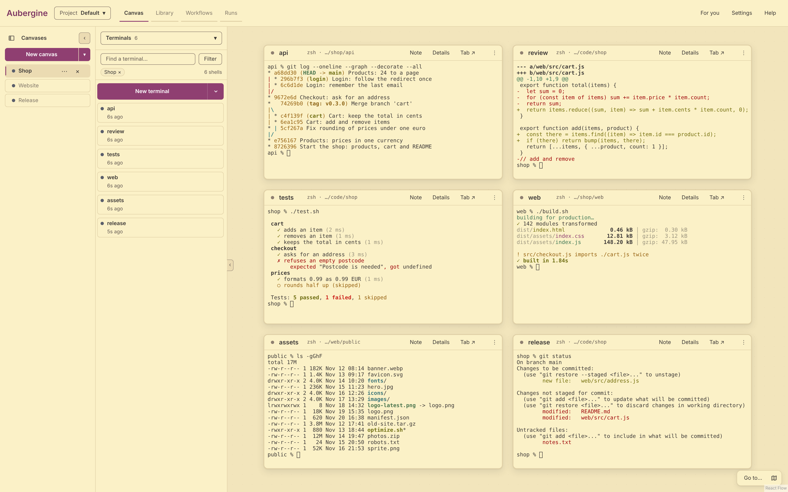

# Aubergine

<sub>هذه ترجمة آلية للجزء الأول من ملف README. التطبيق نفسه باللغة الإنجليزية. ملف README الكامل بالإنجليزية: <a href="../../README.md">README.md</a>.</sub>

**مركز التحكم بطرفياتك ووكلاء البرمجة بالذكاء الاصطناعي.** شغّل Claude Code وCodex والطرفيات العادية جنبًا إلى جنب في لوحة تحكم واحدة في متصفحك: ما شئت منها، بالوكلاء والنماذج التي تستخدمها أصلًا. واعرف بنظرة واحدة أيها ينتظرك، وفي أي خطوة كلٌّ منها، وما كتبه كلٌّ منها لك.

- يعمل على حاسوبك أنت، ولا مكان غيره.
- تبقى الطرفيات تعمل حين تغلق المتصفح أو تعيد تشغيل Aubergine.
- يعمل مع الصدفات العادية ومع الوكلاء.
- ليس لـ Aubergine نموذج خاص به، ولا يحتفظ بأي مفتاح، وليس فيه حساب.
- مصمَّم ليجتاز مراجعة قسم تقنية المعلومات: بعض الشركات لا تسمح بأدوات تحتاج إلى حساب لدى صانعها، أو ترسل شيفرتك إلى سحابته، أو لا يمكن قراءة مصدرها. ليس في Aubergine حساب ولا سحابة، وهو كله مفتوح المصدر. أما الوكلاء الذين تشغّلهم فيه فما زالوا يحتاجون إلى موافقتهم الخاصة.


<sub>العرض التجريبي المرفق مع Aubergine: وكلاء بدلاء، لا وكلاء حقيقيون. المزيد في <a href="#what-it-looks-like">كيف يبدو</a>.</sub>

---

<a id="what-it-looks-like"></a>

## كيف يبدو

| | |
|---|---|
|  |  |
| **Runs.** ينتقل العمل من اليسار إلى اليمين: بانتظار البدء، قيد التشغيل، بانتظارك، منتهية. | **By step.** كل سير عمل مع عمود لكل خطوة، وكل تشغيل حيث يقف. |
|  |  |
| **Workflows.** قوائم خطوات يمرّ بها وكيل، خطوةً خطوة. | **Library.** اقرأ بالضبط ما سيُقال لوكيل قبل أن تثبّت أي شيء. |

### أنماط الألوان

تأتي الصفحة في عشرة أنماط ألوان، أربعة فاتحة وستة داكنة، تُختار في **Settings → Appearance**. ويمكن لأي طرفية أن يكون لها نمطها الخاص (**Theme…** في قائمتها)، وتتبع الطرفيات الأخرى النمط الافتراضي الذي تضبطه للطرفيات، أو الصفحة. ويمكن ضبط ألوان منفردة يدويًا في [ملف الإعدادات](../../README.md#settings).

| | | |
|---|---|---|
|  |  |  |
| **Light** | **Solarized light** | **Gruvbox light** |
|  |  |  |
| **Nord** | **Dracula** | **Gruvbox dark** |

وأيضًا [Dark](../../site/screenshots/themes-dark.png), [High contrast light](../../site/screenshots/themes-high-contrast-light.png), [High contrast dark](../../site/screenshots/themes-high-contrast-dark.png) و [Solarized dark](../../site/screenshots/themes-solarized-dark.png).


<sub>ست طرفيات على صفحة داكنة، لكل منها نمطها الخاص. مشروع مختلق في صدفات عادية.</sub>

---

## ابدأ في دقيقتين

**1. التثبيت** (macOS مع tmux 3.2 أو أحدث، ومعه Node.js 22 أو أحدث؛ الأمر `brew install tmux node` يثبّت الاثنين)

```sh
# Node.js 22 or newer
npm install -g @meatgarden/aubergine
```

أو بالمثبِّت، الذي يحتاج أيضًا إلى pnpm ويبني من الشيفرة المصدرية:

```sh
curl -fsSL https://raw.githubusercontent.com/thirstyeggplant/aubergine/main/install.sh | sh
```

**2. شغّله وافتح متصفحك**

```sh
aubergine start --open
```

**3. انقر «Show me around»** (عرّفني بالمكان) في وسط اللوحة الفارغة.

يصنع لوحة اسمها «Demo» فيها بضعة وكلاء بدلاء ويمرّ بك في ثماني خطوات قصيرة، نحو خمس دقائق. لا شيء فيها حقيقي، و**Remove the demo** يزيلها من جديد.

**أو دع وكيلك يثبّته.** الصق هذا في وكيل البرمجة الذي تستخدمه أصلًا. يتحقق مما يحتاجه Aubergine، ويثبّته، ويضيف بضعة أسطر إلى تعليمات مشروعك ليعرف كيف يعمل في طرفية Aubergine.

```text
Install Aubergine on this computer for me, then learn how to work in it.
Aubergine shows my terminals and coding agents side by side in a browser page. It runs only on this computer and is built for macOS.

1. Check what it needs: tmux 3.2 or newer and Node.js 22 or newer. Run `tmux -V` and `node --version`. If one is missing or too old, tell me the command that would install it (with Homebrew: `brew install tmux node`) and wait for my answer. Do not use sudo.
2. Install it: `npm install -g @meatgarden/aubergine`
3. Run `aubergine doctor` and read what it says. Fix what is yours to fix and tell me the rest.
4. Do not start the server yourself: it runs until it is stopped, and it opens my browser. Tell me to run `aubergine start --open` in a terminal of my own, and to click "Show me around" on the empty canvas.
5. So that you and later agents know how to work in an Aubergine terminal, run `aubergine guide --snippet` and add the lines it prints to this project's instructions for agents (the file you read at the start of every conversation). Show me the change before you save it.
6. From now on, whenever the environment variable AUBERGINE_SESSION_ID is set, you are in an Aubergine terminal: run `aubergine guide` once, before other work, and report to me as it says.

Finish by telling me what you installed, what you changed, and anything that did not work.
```

الموجّه بالإنجليزية، مثل Aubergine نفسه؛ ويمكن لوكيلك أن يجيبك بلغتك. لم يُشغَّل بعد مع وكيل حقيقي، فاقرأ ما يقترحه وكيلك قبل أن توافق. ما يستطيع الوكيل فعله في طرفية موجود في [دليل الوكلاء](../for-agents.md).

هل هناك خلل؟ شغّل `aubergine doctor`، أو انظر [If something goes wrong](../../README.md#if-something-goes-wrong). المثبِّت موصوف بالكامل تحت [Quick start](../../README.md#quick-start).

---

لكل ما سوى ذلك، اقرأ [ملف README الكامل بالإنجليزية](../../README.md).
