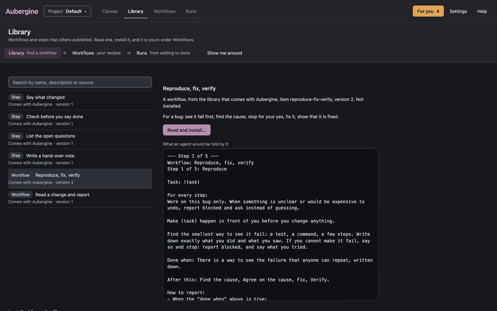

# Aubergine

<sub>এটি README-এর উপরের অংশের মেশিনে করা অনুবাদ। অ্যাপটি নিজে ইংরেজিতে। পুরো README ইংরেজিতে: [README.md](../../README.md)।</sub>

**আপনার টার্মিনাল আর AI কোডিং এজেন্টদের জন্য মিশন কন্ট্রোল।** Claude Code, Codex আর সাধারণ টার্মিনাল ব্রাউজারে একটি ড্যাশবোর্ডে পাশাপাশি চালান: যত খুশি, যে এজেন্ট আর মডেল আপনি আগে থেকেই ব্যবহার করেন সেগুলো দিয়ে। এক নজরে দেখুন কোনটি আপনার অপেক্ষায়, প্রতিটি কোন ধাপে আছে, আর প্রতিটি আপনার জন্য কী লিখেছে।

- আপনার নিজের কম্পিউটারে চলে, আর কোথাও নয়।
- ব্রাউজার বন্ধ করলে বা Aubergine রিস্টার্ট করলেও টার্মিনাল চলতে থাকে।
- সাধারণ শেলের সঙ্গেও কাজ করে, এজেন্টের সঙ্গেও।
- Aubergine-এর নিজের কোনো মডেল নেই, এটি কোনো key রাখে না, আর এর কোনো অ্যাকাউন্ট নেই।


<sub>Aubergine-এর সঙ্গে আসা ডেমো: নকল এজেন্ট, আসল নয়। আরও আছে <a href="#what-it-looks-like">দেখতে কেমন</a> অংশে।</sub>

---

<a id="what-it-looks-like"></a>

## দেখতে কেমন

| | |
|---|---|
|  |  |
| **Runs.** কাজ বাঁ থেকে ডানে এগোয়: শুরুর অপেক্ষায়, চলছে, আপনার অপেক্ষায়, শেষ। | **By step.** প্রতিটি ওয়ার্কফ্লো, প্রতিটি ধাপের জন্য একটি কলাম সহ, আর প্রতিটি রান যেখানে দাঁড়িয়ে আছে। |
|  |  |
| **Workflows.** ধাপের তালিকা যা একটি এজেন্ট একটির পর একটি পার হয়। | **Library.** কিছু ইনস্টল করার আগে ঠিক তা-ই পড়ুন যা একটি এজেন্টকে বলা হবে। |

### কালার থিম

পেজটি দশটি কালার থিমে আসে, চারটি লাইট আর ছয়টি ডার্ক, যা **Settings → Appearance**-এ বেছে নেওয়া হয়। যেকোনো টার্মিনালের নিজের থিমও থাকতে পারে (তার মেনুতে **Theme…**), আর বাকিগুলো টার্মিনালের জন্য আপনার সেট করা ডিফল্ট বা পেজকে অনুসরণ করে। আলাদা আলাদা রং [সেটিংস ফাইলে](../../README.md#settings) হাতে সেট করা যায়।

| | | |
|---|---|---|
|  |  |  |
| **Light** | **Solarized light** | **Gruvbox light** |
|  |  |  |
| **Nord** | **Dracula** | **Gruvbox dark** |

এ ছাড়া [Dark](../../site/screenshots/themes-dark.png), [High contrast light](../../site/screenshots/themes-high-contrast-light.png), [High contrast dark](../../site/screenshots/themes-high-contrast-dark.png) আর [Solarized dark](../../site/screenshots/themes-solarized-dark.png)।


<sub>ডার্ক পেজে ছয়টি টার্মিনাল, প্রতিটি নিজের থিমে। সাধারণ শেলে একটি বানানো প্রজেক্ট।</sub>

---

## দুই মিনিটে শুরু করুন

**1. ইনস্টল করুন** (macOS, সঙ্গে tmux 3.2 বা নতুনতর আর Node.js 22 বা নতুনতর; `brew install tmux node` দুটোই এনে দেয়)

```sh
# Node.js 22 or newer
npm install -g @meatgarden/aubergine
```

অথবা ইনস্টলার দিয়ে, যার pnpm-ও লাগে আর যা সোর্স থেকে বিল্ড করে:

```sh
curl -fsSL https://raw.githubusercontent.com/thirstyeggplant/aubergine/main/install.sh | sh
```

**2. চালু করুন আর ব্রাউজার খুলুন**

```sh
aubergine start --open
```

**3. ফাঁকা ক্যানভাসের মাঝখানে "Show me around"-এ ক্লিক করুন।**

এটি "Demo" নামের একটি ক্যানভাস বানায়, কয়েকটি নকল এজেন্ট সহ, আর আটটি ছোট ধাপে আপনাকে ঘুরিয়ে দেখায়, মোটামুটি পাঁচ মিনিট। এর কিছুই আসল নয়, আর **Remove the demo** সেটি আবার সরিয়ে দেয়।

কিছু ঠিক নেই? `aubergine doctor` চালান, বা দেখুন [If something goes wrong](../../README.md#if-something-goes-wrong)। ইনস্টলারের পুরো বিবরণ আছে [Quick start](../../README.md#quick-start)-এ।

---

বাকি সবকিছু ইংরেজি README-তে: [README.md](../../README.md)।
