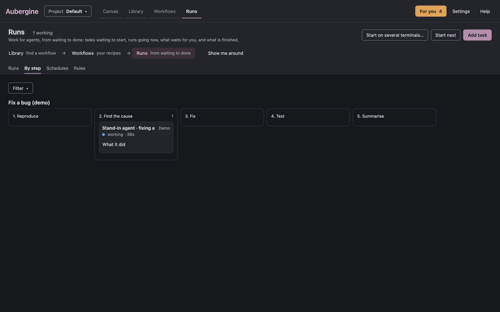
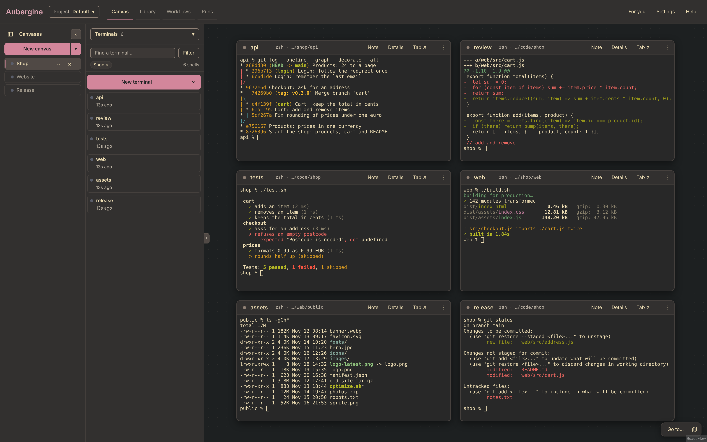
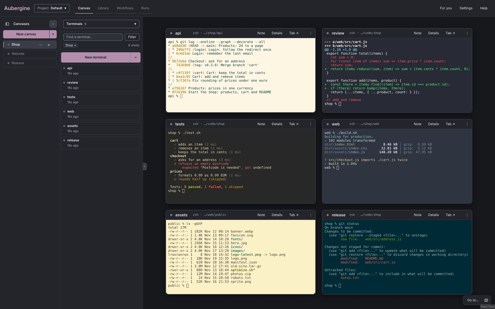

# Aubergine

<sub>এটি README-এর উপরের অংশের মেশিনে করা অনুবাদ। অ্যাপটি নিজে ইংরেজিতে। পুরো README ইংরেজিতে: [README.md](../../README.md)।</sub>

**আপনার টার্মিনাল আর AI কোডিং এজেন্টদের জন্য মিশন কন্ট্রোল।** Claude Code, Codex আর সাধারণ টার্মিনাল ব্রাউজারে একটি ড্যাশবোর্ডে পাশাপাশি চালান: যত খুশি, যে এজেন্ট আর মডেল আপনি আগে থেকেই ব্যবহার করেন সেগুলো দিয়ে। এক নজরে দেখুন কোনটি আপনার অপেক্ষায়, প্রতিটি কোন ধাপে আছে, আর প্রতিটি আপনার জন্য কী লিখেছে।

Aubergine শেয়ার করুন: [X](https://x.com/intent/post?text=Aubergine%3A%20mission%20control%20for%20your%20terminals%20and%20AI%20coding%20agents.%20Free%2C%20local%2C%20open%20source.&url=https%3A%2F%2Fthirstyeggplant.com%2F) · [Bluesky](https://bsky.app/intent/compose?text=Aubergine%3A%20mission%20control%20for%20your%20terminals%20and%20AI%20coding%20agents.%20Free%2C%20local%2C%20open%20source.%20https%3A%2F%2Fthirstyeggplant.com%2F) · [LinkedIn](https://www.linkedin.com/sharing/share-offsite/?url=https%3A%2F%2Fthirstyeggplant.com%2F) · [Reddit](https://www.reddit.com/submit?url=https%3A%2F%2Fthirstyeggplant.com%2F&title=Aubergine%3A%20mission%20control%20for%20your%20terminals%20and%20AI%20coding%20agents.%20Free%2C%20local%2C%20open%20source.) · [Hacker News](https://news.ycombinator.com/submitlink?u=https%3A%2F%2Fthirstyeggplant.com%2F&t=Aubergine%3A%20mission%20control%20for%20your%20terminals%20and%20AI%20coding%20agents.%20Free%2C%20local%2C%20open%20source.)

- আপনার নিজের কম্পিউটারে চলে, আর কোথাও নয়।
- ব্রাউজার বন্ধ করলে বা Aubergine রিস্টার্ট করলেও টার্মিনাল চলতে থাকে।
- সাধারণ শেলের সঙ্গেও কাজ করে, এজেন্টের সঙ্গেও।
- Aubergine-এর নিজের কোনো মডেল নেই, এটি কোনো key রাখে না, আর এর কোনো অ্যাকাউন্ট নেই।
- IT পর্যালোচনায় পাস করার জন্য বানানো: কিছু কোম্পানি এমন টুল অনুমোদন করে না যেগুলোর জন্য নির্মাতার কাছে অ্যাকাউন্ট লাগে, যেগুলো আপনার কোড তার ক্লাউডে পাঠায়, বা যেগুলোর সোর্স পড়া যায় না। Aubergine-এর কোনো অ্যাকাউন্ট নেই, ক্লাউড নেই, আর এর পুরোটাই ওপেন সোর্স। এর ভেতরে আপনি যে এজেন্ট চালান, সেগুলোর তবুও নিজস্ব অনুমোদন লাগে।


<sub>Aubergine-এর সঙ্গে আসা ডেমো: নকল এজেন্ট, আসল নয়। আরও আছে <a href="#what-it-looks-like">দেখতে কেমন</a> অংশে।</sub>

---

<a id="what-it-looks-like"></a>

## দেখতে কেমন

| | |
|---|---|
|  |  |
| **Runs.** কাজ বাঁ থেকে ডানে এগোয়: শুরুর অপেক্ষায়, চলছে, আপনার অপেক্ষায়, শেষ। | **By step.** প্রতিটি ওয়ার্কফ্লো, প্রতিটি ধাপের জন্য একটি কলাম সহ, আর প্রতিটি রান যেখানে দাঁড়িয়ে আছে। |
|  |  |
| **Workflows.** ধাপের তালিকা যা একটি এজেন্ট একটির পর একটি পার হয়। | **Library.** কিছু ইনস্টল করার আগে ঠিক তা-ই পড়ুন যা একটি এজেন্টকে বলা হবে। |

### কালার থিম

পেজটি দশটি কালার থিমে আসে, চারটি লাইট আর ছয়টি ডার্ক, যা **Settings → Appearance**-এ বেছে নেওয়া হয়। যেকোনো টার্মিনালের নিজের থিমও থাকতে পারে (তার মেনুতে **Theme…**), আর বাকিগুলো টার্মিনালের জন্য আপনার সেট করা ডিফল্ট বা পেজকে অনুসরণ করে। আলাদা আলাদা রং [সেটিংস ফাইলে](../../README.md#settings) হাতে সেট করা যায়।

| | | |
|---|---|---|
|  |  |  |
| **Light** | **Solarized light** | **Gruvbox light** |
|  |  |  |
| **Nord** | **Dracula** | **Gruvbox dark** |

এ ছাড়া [Dark](../../site/screenshots/themes-dark.png), [High contrast light](../../site/screenshots/themes-high-contrast-light.png), [High contrast dark](../../site/screenshots/themes-high-contrast-dark.png) আর [Solarized dark](../../site/screenshots/themes-solarized-dark.png)।



<sub>ডার্ক পেজে ছয়টি টার্মিনাল, প্রতিটি নিজের থিমে। সাধারণ শেলে একটি বানানো প্রজেক্ট।</sub>

---

## দুই মিনিটে শুরু করুন

**1. ইনস্টল করুন** (macOS, সঙ্গে tmux 3.2 বা নতুনতর আর Node.js 22 বা নতুনতর; `brew install tmux node` দুটোই এনে দেয়)

```sh
# Node.js 22 or newer
npm install -g @meatgarden/aubergine
```

অথবা ইনস্টলার দিয়ে, যার pnpm-ও লাগে আর যা সোর্স থেকে বিল্ড করে:

```sh
curl -fsSL https://raw.githubusercontent.com/thirstyeggplant/aubergine/main/install.sh | sh
```

**2. চালু করুন আর ব্রাউজার খুলুন**

```sh
aubergine start --open
```

**3. ফাঁকা ক্যানভাসের মাঝখানে "Show me around"-এ ক্লিক করুন।**

এটি "Demo" নামের একটি ক্যানভাস বানায়, কয়েকটি নকল এজেন্ট সহ, আর আটটি ছোট ধাপে আপনাকে ঘুরিয়ে দেখায়, মোটামুটি পাঁচ মিনিট। এর কিছুই আসল নয়, আর **Remove the demo** সেটি আবার সরিয়ে দেয়।

**অথবা আপনার এজেন্টকে দিয়ে ইনস্টল করান।** আপনি যে কোডিং এজেন্ট আগে থেকেই ব্যবহার করেন, তাতে এটি পেস্ট করুন। এটি দেখে নেয় Aubergine-এর কী লাগে, সেটি ইনস্টল করে, আর আপনার প্রজেক্টের নির্দেশনায় কয়েকটি লাইন যোগ করে, যাতে এটি জানে Aubergine টার্মিনালে কীভাবে কাজ করতে হয়।

```text
Install Aubergine on this computer for me, then learn how to work in it.
Aubergine shows my terminals and coding agents side by side in a browser page. It runs only on this computer and is built for macOS.

1. Check what it needs: tmux 3.2 or newer and Node.js 22 or newer. Run `tmux -V` and `node --version`. If one is missing or too old, tell me the command that would install it (with Homebrew: `brew install tmux node`) and wait for my answer. Do not use sudo.
2. Install it: `npm install -g @meatgarden/aubergine`
3. Run `aubergine doctor` and read what it says. Fix what is yours to fix and tell me the rest.
4. Do not start the server yourself: it runs until it is stopped, and it opens my browser. Tell me to run `aubergine start --open` in a terminal of my own, and to click "Show me around" on the empty canvas.
5. So that you and later agents know how to work in an Aubergine terminal, run `aubergine guide --snippet` and add the lines it prints to this project's instructions for agents (the file you read at the start of every conversation). Show me the change before you save it.
6. From now on, whenever the environment variable AUBERGINE_SESSION_ID is set, you are in an Aubergine terminal: run `aubergine guide` once, before other work, and report to me as it says.

Finish by telling me what you installed, what you changed, and anything that did not work.
```

Aubergine-এর মতো প্রম্পটটিও ইংরেজিতে; আপনার এজেন্ট আপনার ভাষায় উত্তর দিতে পারে। এটি এখনো কোনো আসল এজেন্টের সঙ্গে চালানো হয়নি, তাই হ্যাঁ বলার আগে আপনার এজেন্ট কী প্রস্তাব করে তা পড়ে নিন। একটি এজেন্ট টার্মিনালে কী করতে পারে তা আছে [এজেন্টদের গাইডে](../for-agents.md)।

কিছু ঠিক নেই? `aubergine doctor` চালান, বা দেখুন [If something goes wrong](../../README.md#if-something-goes-wrong)। ইনস্টলারের পুরো বিবরণ আছে [Quick start](../../README.md#quick-start)-এ।

---

বাকি সবকিছু ইংরেজি README-তে: [README.md](../../README.md)।
