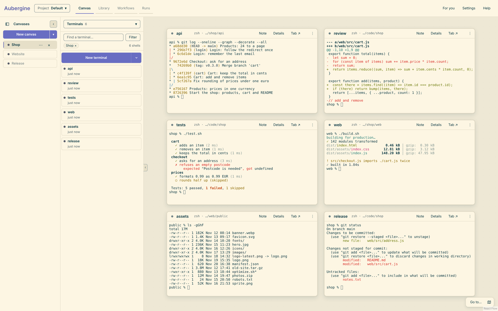
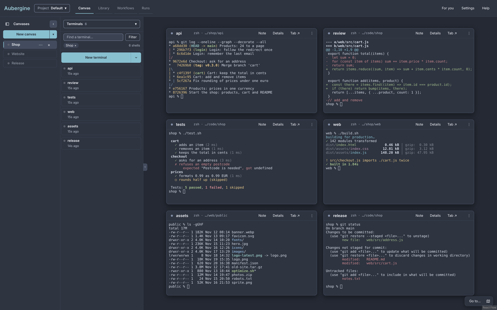

# Aubergine

*Traduction automatique du début du README. L’application elle-même est en anglais. Le README complet est en anglais : [README.md](../../README.md).*

**Le centre de contrôle de vos terminaux et agents de code IA.** Lancez Claude Code, Codex et des terminaux ordinaires côte à côte dans un seul tableau de bord, dans votre navigateur : autant que vous voulez, avec les agents et les modèles que vous utilisez déjà. Voyez d’un coup d’œil lequel vous attend, à quelle étape en est chacun, et ce que chacun a écrit pour vous.

- Tourne sur votre propre ordinateur, et nulle part ailleurs.
- Les terminaux continuent de tourner quand vous fermez le navigateur ou redémarrez Aubergine.
- Fonctionne avec de simples shells comme avec des agents.
- Aubergine n’a pas de modèle à elle, ne détient aucune clé et n’a pas de compte.


<sub>La démo fournie avec Aubergine : des agents factices, pas de vrais agents. Plus d’images dans <a href="#what-it-looks-like">À quoi ça ressemble</a>.</sub>

---

<a id="what-it-looks-like"></a>

## À quoi ça ressemble

| | |
|---|---|
|  |  |
| **Runs.** Le travail avance de gauche à droite : en attente de démarrage, en cours, en attente de vous, terminé. | **By step.** Chaque workflow avec une colonne par étape, et chaque exécution là où elle en est. |
|  |  |
| **Workflows.** Des listes d’étapes qu’un agent suit, une à la fois. | **Library.** Lisez exactement ce qu’un agent recevrait comme consignes avant d’installer quoi que ce soit. |

### Thèmes de couleurs

La page existe en dix thèmes de couleurs, quatre clairs et six sombres, choisis dans **Settings → Appearance**. Chaque terminal peut aussi avoir son propre thème (**Theme…** dans son menu), et les autres suivent le thème par défaut que vous choisissez pour les terminaux, ou la page. Des couleurs isolées se règlent à la main dans le [fichier de réglages](../../README.md#settings).

| | | |
|---|---|---|
|  |  |  |
| **Light** | **Solarized light** | **Gruvbox light** |
|  |  |  |
| **Nord** | **Dracula** | **Gruvbox dark** |

Et aussi [Dark](../../site/screenshots/themes-dark.png), [High contrast light](../../site/screenshots/themes-high-contrast-light.png), [High contrast dark](../../site/screenshots/themes-high-contrast-dark.png) et [Solarized dark](../../site/screenshots/themes-solarized-dark.png).


<sub>Six terminaux sur une page sombre, chacun dans son propre thème. Un projet inventé, dans de simples shells.</sub>

---

## Démarrer en deux minutes

**1. Installer** (macOS avec tmux 3.2 ou plus récent et Node.js 22 ou plus récent ; `brew install tmux node` installe les deux)

```sh
# Node.js 22 or newer
npm install -g @meatgarden/aubergine
```

Ou avec le script d’installation, qui a aussi besoin de pnpm et compile depuis le code source :

```sh
curl -fsSL https://raw.githubusercontent.com/thirstyeggplant/aubergine/main/install.sh | sh
```

**2. Lancez-la et ouvrez votre navigateur**

```sh
aubergine start --open
```

**3. Cliquez sur « Show me around »** au milieu du canevas vide.

Cela crée un canevas nommé « Demo » avec quelques agents factices et vous fait faire le tour en huit courtes étapes, environ cinq minutes. Rien n’y est réel, et **Remove the demo** le retire.

Quelque chose ne va pas ? Exécutez `aubergine doctor`, ou voyez [If something goes wrong](../../README.md#if-something-goes-wrong). Le script d’installation est décrit en entier sous [Quick start](../../README.md#quick-start).

---

Pour tout le reste, voir le [README en anglais](../../README.md).
