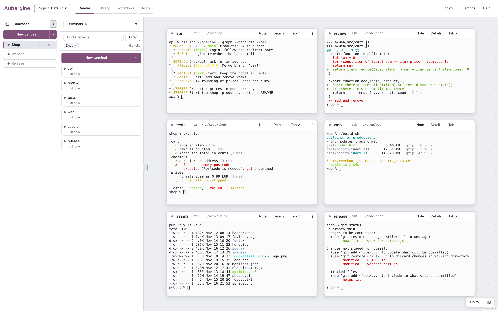

# Aubergine

<sub>यह README के ऊपरी हिस्से का मशीन से किया गया अनुवाद है। ऐप खुद अंग्रेज़ी में है। पूरा README अंग्रेज़ी में: [README.md](../../README.md)।</sub>

**आपके टर्मिनलों और AI कोडिंग एजेंटों के लिए मिशन कंट्रोल।** Claude Code, Codex और सादे टर्मिनल अपने ब्राउज़र में एक ही डैशबोर्ड पर साथ-साथ चलाएँ: जितने चाहें उतने, उन्हीं एजेंटों और मॉडलों के साथ जो आप पहले से इस्तेमाल करते हैं। एक नज़र में देखें कि कौन-सा आपका इंतज़ार कर रहा है, हर एक किस स्टेप पर है, और हर एक ने आपके लिए क्या लिखा है।

- आपके अपने कंप्यूटर पर चलता है, और कहीं नहीं।
- ब्राउज़र बंद करने या Aubergine रीस्टार्ट करने पर भी टर्मिनल चलते रहते हैं।
- सादे शेल के साथ भी काम करता है और एजेंटों के साथ भी।
- Aubergine का अपना कोई मॉडल नहीं है, यह कोई key नहीं रखता और इसमें कोई अकाउंट नहीं है।


<sub>Aubergine के साथ आने वाला डेमो: नकली एजेंट, असली नहीं। ज़्यादा <a href="#what-it-looks-like">यह दिखता कैसा है</a> में।</sub>

---

<a id="what-it-looks-like"></a>

## यह दिखता कैसा है

| | |
|---|---|
|  |  |
| **Runs.** काम बाएँ से दाएँ बढ़ता है: शुरू होने का इंतज़ार, चल रहा है, आपका इंतज़ार, पूरा। | **By step.** हर वर्कफ़्लो, हर स्टेप के लिए एक कॉलम के साथ, और हर रन वहाँ जहाँ वह खड़ा है। |
|  |  |
| **Workflows.** स्टेप की सूचियाँ जिनसे एजेंट एक-एक करके गुज़रता है। | **Library.** कुछ भी इंस्टॉल करने से पहले ठीक वही पढ़ें जो किसी एजेंट को बताया जाएगा। |

### कलर थीम

पेज दस कलर थीम में आता है, चार लाइट और छह डार्क, जो **Settings → Appearance** में चुनी जाती हैं। कोई भी टर्मिनल अपनी थीम भी रख सकता है (उसके मेन्यू में **Theme…**), और बाकी उस डिफ़ॉल्ट पर चलते हैं जो आप टर्मिनलों के लिए सेट करते हैं, या पेज पर। अलग-अलग रंग [सेटिंग्स फ़ाइल](../../README.md#settings) में हाथ से सेट किए जा सकते हैं।

| | | |
|---|---|---|
|  |  |  |
| **Light** | **Solarized light** | **Gruvbox light** |
|  |  |  |
| **Nord** | **Dracula** | **Gruvbox dark** |

इनके अलावा [Dark](../../site/screenshots/themes-dark.png), [High contrast light](../../site/screenshots/themes-high-contrast-light.png), [High contrast dark](../../site/screenshots/themes-high-contrast-dark.png) और [Solarized dark](../../site/screenshots/themes-solarized-dark.png)।


<sub>डार्क पेज पर छह टर्मिनल, हर एक अपनी थीम में। साधारण शेल में एक काल्पनिक प्रोजेक्ट।</sub>

---

## दो मिनट में शुरू करें

**1. इंस्टॉल करें** (macOS, tmux 3.2 या नए और Node.js 22 या नए के साथ; `brew install tmux node` दोनों ले आता है)

```sh
# Node.js 22 or newer
npm install -g @meatgarden/aubergine
```

या इंस्टॉलर से, जिसे pnpm भी चाहिए और जो सोर्स से बिल्ड करता है:

```sh
curl -fsSL https://raw.githubusercontent.com/thirstyeggplant/aubergine/main/install.sh | sh
```

**2. इसे शुरू करें और अपना ब्राउज़र खोलें**

```sh
aubergine start --open
```

**3. खाली कैनवस के बीच में "Show me around" पर क्लिक करें।**

यह "Demo" नाम का एक कैनवस बनाता है जिसमें कुछ नकली एजेंट होते हैं, और आपको आठ छोटे स्टेप में घुमाता है, लगभग पाँच मिनट। इसमें कुछ भी असली नहीं है, और **Remove the demo** उसे फिर हटा देता है।

कुछ ठीक नहीं है? `aubergine doctor` चलाएँ, या देखें [If something goes wrong](../../README.md#if-something-goes-wrong)। इंस्टॉलर का पूरा ब्योरा [Quick start](../../README.md#quick-start) में है।

---

बाकी सब कुछ अंग्रेज़ी README में है: [README.md](../../README.md)।
