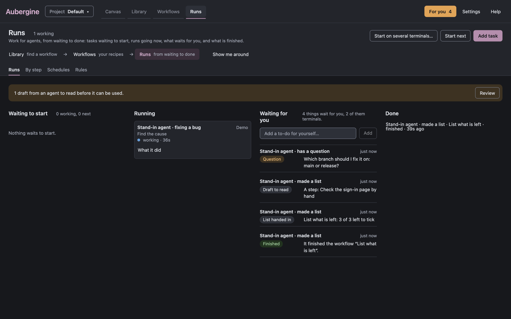

# Aubergine

<sub>Ini adalah terjemahan mesin dari bagian awal README. Aplikasinya sendiri berbahasa Inggris. README lengkap dalam bahasa Inggris: <a href="../../README.md">README.md</a>.</sub>

**Semua terminal Anda di satu kanvas di browser.** Jalankan beberapa agen coding berdampingan dan lihat sekilas mana yang menunggu Anda, di langkah mana masing-masing berada, dan apa yang sudah ditulis masing-masing untuk Anda.

- Berjalan di komputer Anda sendiri, dan tidak di tempat lain.
- Terminal tetap berjalan saat Anda menutup browser atau memulai ulang Aubergine.
- Bekerja dengan shell biasa maupun dengan agen.
- Terminal sebanyak yang Anda mau, berdampingan.
- Bawa agen dan model Anda sendiri: Aubergine tidak punya model sendiri, tidak menyimpan kunci, dan tidak punya akun.


<sub>Demo yang disertakan dengan Aubergine: agen pengganti, bukan agen sungguhan. Selengkapnya di <a href="#what-it-looks-like">Seperti apa tampilannya</a>.</sub>

---

<a id="what-it-looks-like"></a>

## Seperti apa tampilannya

| | |
|---|---|
|  |  |
| **Runs.** Pekerjaan bergerak dari kiri ke kanan: menunggu dimulai, berjalan, menunggu Anda, selesai. | **By step.** Setiap workflow dengan satu kolom untuk tiap langkah, dan setiap run di posisinya. |
|  |  |
| **Workflows.** Daftar langkah yang dilalui agen, satu per satu. | **Library.** Baca persis apa yang akan disampaikan kepada agen sebelum Anda menginstal apa pun. |

---

## Mulai dalam dua menit

**1. Instal** (macOS dengan tmux 3.2 atau lebih baru dan Node.js 22 atau lebih baru; `brew install tmux node` memasang keduanya)

```sh
# Node.js 22 or newer
npm install -g @meatgarden/aubergine
```

Atau dengan installer, yang juga memerlukan pnpm dan membangun dari kode sumber:

```sh
curl -fsSL https://raw.githubusercontent.com/thirstyeggplant/aubergine/main/install.sh | sh
```

**2. Jalankan dan buka browser**

```sh
aubergine start --open
```

**3. Klik "Show me around"** (Tunjukkan sekeliling) di tengah kanvas kosong.

Ia membuat kanvas bernama "Demo" dengan beberapa agen pengganti dan memandu Anda dalam delapan langkah singkat, sekitar lima menit. Tidak ada yang sungguhan di dalamnya, dan **Remove the demo** menghapusnya lagi.

Ada yang tidak beres? Jalankan `aubergine doctor`, atau lihat [If something goes wrong](../../README.md#if-something-goes-wrong) (Jika ada yang salah). Installer dijelaskan selengkapnya di [Quick start](../../README.md#quick-start).

---

Untuk semua hal lainnya, baca [README lengkap dalam bahasa Inggris](../../README.md).
