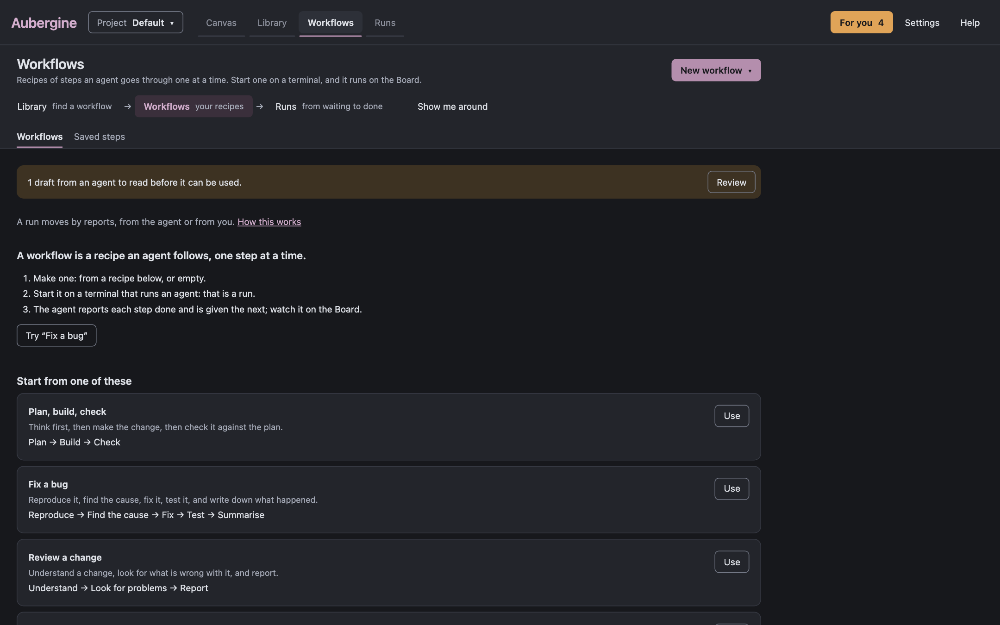

# Aubergine

<sub>README 앞부분을 기계 번역한 것입니다. 앱 자체는 영어로 되어 있습니다. 영어로 된 전체 README: <a href="../../README.md">README.md</a>.</sub>

**터미널과 AI 코딩 에이전트를 위한 관제 센터.** Claude Code, Codex, 일반 터미널을 브라우저 속 하나의 대시보드에 나란히 놓고 실행하세요. 이미 쓰고 있는 에이전트와 모델로, 원하는 만큼. 어느 것이 여러분을 기다리는지, 각각 어느 단계에 있는지, 각각 여러분을 위해 무엇을 써 두었는지 한눈에 확인하세요.

- 여러분의 컴퓨터에서만 실행되며, 다른 어디에서도 실행되지 않습니다.
- 브라우저를 닫거나 Aubergine을 다시 시작해도 터미널은 계속 실행됩니다.
- 일반 셸에서도, 에이전트에서도 동작합니다.
- Aubergine에는 자체 모델이 없고, 키를 보관하지 않으며, 계정도 없습니다.


<sub>Aubergine에 포함된 데모입니다. 진짜 에이전트가 아닌 대역 에이전트입니다. 더 많은 화면은 <a href="#what-it-looks-like">실제 모습</a>에 있습니다.</sub>

---

<a id="what-it-looks-like"></a>

## 실제 모습

| | |
|---|---|
|  |  |
| **Runs.** 작업은 왼쪽에서 오른쪽으로 이동합니다. 시작 대기, 실행 중, 여러분을 기다리는 중, 완료. | **By step.** 워크플로마다 단계별로 열이 있고, 모든 실행이 현재 위치에 놓입니다. |
|  |  |
| **Workflows.** 에이전트가 하나씩 거쳐 가는 단계 목록. | **Library.** 무엇이든 설치하기 전에, 에이전트가 듣게 될 내용을 정확히 읽어 보세요. |

### 색 테마

페이지에는 10가지 색 테마가 있습니다. 밝은 테마 4개와 어두운 테마 6개이며 **Settings → Appearance**에서 고릅니다. 어느 터미널이든 자기 테마를 가질 수 있고(메뉴의 **Theme…**), 나머지는 터미널용으로 정한 기본 테마나 페이지를 따릅니다. 개별 색은 [설정 파일](../../README.md#settings)에서 직접 지정할 수 있습니다.

| | | |
|---|---|---|
|  |  |  |
| **Light** | **Solarized light** | **Gruvbox light** |
|  |  |  |
| **Nord** | **Dracula** | **Gruvbox dark** |

그 밖에 [Dark](../../site/screenshots/themes-dark.png), [High contrast light](../../site/screenshots/themes-high-contrast-light.png), [High contrast dark](../../site/screenshots/themes-high-contrast-dark.png), [Solarized dark](../../site/screenshots/themes-solarized-dark.png)도 있습니다.


<sub>어두운 페이지의 터미널 6개, 각각 자기 테마로. 지어낸 프로젝트를 평범한 셸에서.</sub>

---

## 2분 만에 시작하기

**1. 설치** (tmux 3.2 이상과 Node.js 22 이상이 설치된 macOS. `brew install tmux node`로 둘 다 설치할 수 있습니다)

```sh
# Node.js 22 or newer
npm install -g @meatgarden/aubergine
```

또는 pnpm도 필요하고 소스에서 빌드하는 설치 프로그램으로:

```sh
curl -fsSL https://raw.githubusercontent.com/thirstyeggplant/aubergine/main/install.sh | sh
```

**2. 시작하고 브라우저 열기**

```sh
aubergine start --open
```

**3. 빈 캔버스 가운데에서 "Show me around"(둘러보기)를 클릭하세요.**

대역 에이전트 몇 개가 있는 "Demo"라는 캔버스를 만들고, 여덟 개의 짧은 단계로 5분 정도 안내합니다. 그 안의 어떤 것도 진짜가 아니며, **Remove the demo**로 다시 없앨 수 있습니다.

**또는 에이전트에게 설치를 맡기세요.** 이미 쓰고 있는 코딩 에이전트에 이것을 붙여 넣으세요. Aubergine에 필요한 것을 확인하고 설치한 뒤, Aubergine 터미널에서 일하는 방법을 알 수 있도록 프로젝트 지침에 몇 줄을 추가합니다.

```text
Install Aubergine on this computer for me, then learn how to work in it.
Aubergine shows my terminals and coding agents side by side in a browser page. It runs only on this computer and is built for macOS.

1. Check what it needs: tmux 3.2 or newer and Node.js 22 or newer. Run `tmux -V` and `node --version`. If one is missing or too old, tell me the command that would install it (with Homebrew: `brew install tmux node`) and wait for my answer. Do not use sudo.
2. Install it: `npm install -g @meatgarden/aubergine`
3. Run `aubergine doctor` and read what it says. Fix what is yours to fix and tell me the rest.
4. Do not start the server yourself: it runs until it is stopped, and it opens my browser. Tell me to run `aubergine start --open` in a terminal of my own, and to click "Show me around" on the empty canvas.
5. So that you and later agents know how to work in an Aubergine terminal, run `aubergine guide --snippet` and add the lines it prints to this project's instructions for agents (the file you read at the start of every conversation). Show me the change before you save it.
6. From now on, whenever the environment variable AUBERGINE_SESSION_ID is set, you are in an Aubergine terminal: run `aubergine guide` once, before other work, and report to me as it says.

Finish by telling me what you installed, what you changed, and anything that did not work.
```

Aubergine처럼 프롬프트도 영어로 되어 있지만, 에이전트는 여러분의 언어로 답할 수 있습니다. 아직 실제 에이전트로 실행해 본 적은 없으니, 승인하기 전에 에이전트가 제안하는 내용을 읽어 보세요. 에이전트가 터미널에서 할 수 있는 일은 [에이전트용 가이드](../for-agents.md)에 있습니다.

뭔가 이상한가요? `aubergine doctor`를 실행하거나 [If something goes wrong](../../README.md#if-something-goes-wrong)(문제가 생기면)을 보세요. 설치 프로그램에 대한 전체 설명은 [Quick start](../../README.md#quick-start)에 있습니다.

---

그 밖의 모든 내용은 [영어로 된 전체 README](../../README.md)를 읽어 보세요.
