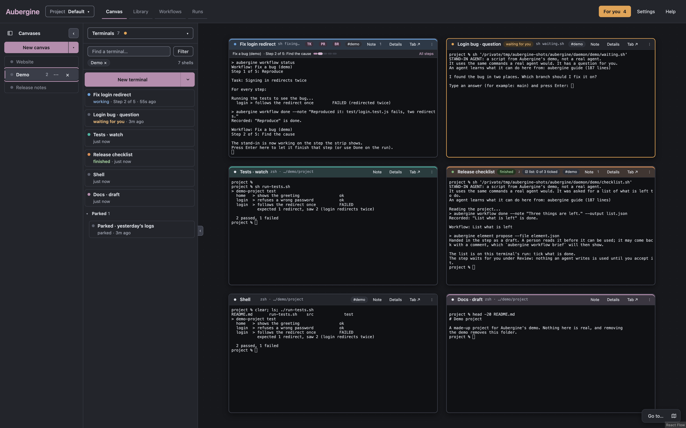

# Aubergine

<sub>Esta é uma tradução automática da parte inicial do README. O app em si está em inglês. O README completo, em inglês: <a href="../../README.md">README.md</a>.</sub>

**Todos os seus terminais em um só canvas, no seu navegador.** Rode vários agentes de programação lado a lado e veja num relance qual está esperando por você, em que etapa cada um está e o que cada um escreveu para você.

- Roda no seu próprio computador, e em nenhum outro lugar.
- Os terminais continuam rodando quando você fecha o navegador ou reinicia o Aubergine.
- Funciona com shells comuns e com agentes.
- Quantos terminais você quiser, lado a lado.
- Traga seus próprios agentes e modelos: o Aubergine não tem modelo próprio, não guarda nenhuma chave e não tem conta.



<sub>A demo que vem com o Aubergine: agentes simulados, nenhum de verdade. Mais em <a href="#como-é">Como é</a>.</sub>

---

## Como é

| | |
|---|---|
|  |  |
| **Runs.** O trabalho anda da esquerda para a direita: esperando para começar, rodando, esperando por você, concluído. | **By step.** Cada fluxo de trabalho com uma coluna para cada etapa, e cada execução onde ela está. |
|  |  |
| **Workflows.** Listas de etapas que um agente percorre, uma de cada vez. | **Library.** Leia exatamente o que seria dito a um agente antes de instalar qualquer coisa. |

---

## Comece em dois minutos

**1. Instale** (macOS com tmux 3.2 ou mais recente e Node.js 22 ou mais recente; `brew install tmux node` instala os dois)

```sh
# Node.js 22 or newer
npm install -g @meatgarden/aubergine
```

Ou com o instalador, que também precisa de pnpm e compila a partir do código-fonte:

```sh
curl -fsSL https://raw.githubusercontent.com/thirstyeggplant/aubergine/main/install.sh | sh
```

**2. Inicie e abra o navegador**

```sh
aubergine start --open
```

**3. Clique em “Show me around”** (me mostre como funciona) no meio do canvas vazio.

Ele cria um canvas chamado “Demo” com alguns agentes simulados e guia você por oito etapas curtas, cerca de cinco minutos. Nada nele é real, e **Remove the demo** (remover a demo) o remove de novo.

Algo não está certo? Rode `aubergine doctor`, ou veja [If something goes wrong](../../README.md#if-something-goes-wrong) (se algo der errado). O instalador é descrito por completo em [Quick start](../../README.md#quick-start).

---

Para todo o resto, leia o [README completo em inglês](../../README.md).
