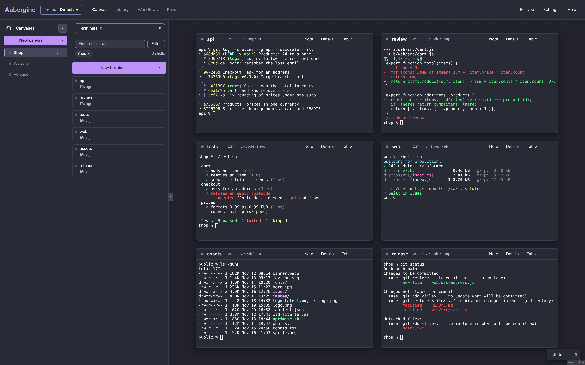

# Aubergine

<sub>Esta é uma tradução automática da parte inicial do README. O app em si está em inglês. O README completo, em inglês: <a href="../../README.md">README.md</a>.</sub>

**Central de controle para seus terminais e agentes de programação com IA.** Rode Claude Code, Codex e terminais comuns lado a lado em um só painel no seu navegador: quantos quiser, com os agentes e modelos que você já usa. Veja num relance qual está esperando por você, em que etapa cada um está e o que cada um escreveu para você.

- Roda no seu próprio computador, e em nenhum outro lugar.
- Os terminais continuam rodando quando você fecha o navegador ou reinicia o Aubergine.
- Funciona com shells comuns e com agentes.
- O Aubergine não tem modelo próprio, não guarda nenhuma chave e não tem conta.


<sub>A demo que vem com o Aubergine: agentes simulados, nenhum de verdade. Mais em <a href="#what-it-looks-like">Como é</a>.</sub>

---

<a id="what-it-looks-like"></a>

## Como é

| | |
|---|---|
|  |  |
| **Runs.** O trabalho anda da esquerda para a direita: esperando para começar, rodando, esperando por você, concluído. | **By step.** Cada fluxo de trabalho com uma coluna para cada etapa, e cada execução onde ela está. |
|  |  |
| **Workflows.** Listas de etapas que um agente percorre, uma de cada vez. | **Library.** Leia exatamente o que seria dito a um agente antes de instalar qualquer coisa. |

### Temas de cores

A página vem em dez temas de cores, quatro claros e seis escuros, escolhidos em **Settings → Appearance**. Qualquer terminal também pode ter um tema próprio (**Theme…** no menu dele), e os outros seguem o padrão que você define para os terminais, ou a página. Cores isoladas podem ser definidas à mão no [arquivo de configurações](../../README.md#settings).

| | | |
|---|---|---|
|  |  |  |
| **Light** | **Solarized light** | **Gruvbox light** |
|  |  |  |
| **Nord** | **Dracula** | **Gruvbox dark** |

Também [Dark](../../site/screenshots/themes-dark.png), [High contrast light](../../site/screenshots/themes-high-contrast-light.png), [High contrast dark](../../site/screenshots/themes-high-contrast-dark.png) e [Solarized dark](../../site/screenshots/themes-solarized-dark.png).


<sub>Seis terminais em uma página escura, cada um em um tema próprio. Um projeto inventado em shells comuns.</sub>

---

## Comece em dois minutos

**1. Instale** (macOS com tmux 3.2 ou mais recente e Node.js 22 ou mais recente; `brew install tmux node` instala os dois)

```sh
# Node.js 22 or newer
npm install -g @meatgarden/aubergine
```

Ou com o instalador, que também precisa de pnpm e compila a partir do código-fonte:

```sh
curl -fsSL https://raw.githubusercontent.com/thirstyeggplant/aubergine/main/install.sh | sh
```

**2. Inicie e abra o navegador**

```sh
aubergine start --open
```

**3. Clique em “Show me around”** (me mostre como funciona) no meio do canvas vazio.

Ele cria um canvas chamado “Demo” com alguns agentes simulados e guia você por oito etapas curtas, cerca de cinco minutos. Nada nele é real, e **Remove the demo** (remover a demo) o remove de novo.

**Ou peça para o seu agente instalar.** Cole isto no agente de programação que você já usa. Ele verifica do que o Aubergine precisa, instala e adiciona algumas linhas às instruções do seu projeto para saber como trabalhar em um terminal do Aubergine.

```text
Install Aubergine on this computer for me, then learn how to work in it.
Aubergine shows my terminals and coding agents side by side in a browser page. It runs only on this computer and is built for macOS.

1. Check what it needs: tmux 3.2 or newer and Node.js 22 or newer. Run `tmux -V` and `node --version`. If one is missing or too old, tell me the command that would install it (with Homebrew: `brew install tmux node`) and wait for my answer. Do not use sudo.
2. Install it: `npm install -g @meatgarden/aubergine`
3. Run `aubergine doctor` and read what it says. Fix what is yours to fix and tell me the rest.
4. Do not start the server yourself: it runs until it is stopped, and it opens my browser. Tell me to run `aubergine start --open` in a terminal of my own, and to click "Show me around" on the empty canvas.
5. So that you and later agents know how to work in an Aubergine terminal, run `aubergine guide --snippet` and add the lines it prints to this project's instructions for agents (the file you read at the start of every conversation). Show me the change before you save it.
6. From now on, whenever the environment variable AUBERGINE_SESSION_ID is set, you are in an Aubergine terminal: run `aubergine guide` once, before other work, and report to me as it says.

Finish by telling me what you installed, what you changed, and anything that did not work.
```

O prompt está em inglês, como o Aubergine; seu agente pode responder no seu idioma. Ele ainda não foi rodado com um agente real, então leia o que o seu propõe antes de dizer sim. O que um agente pode fazer em um terminal está no [guia para agentes](../for-agents.md).

Algo não está certo? Rode `aubergine doctor`, ou veja [If something goes wrong](../../README.md#if-something-goes-wrong) (se algo der errado). O instalador é descrito por completo em [Quick start](../../README.md#quick-start).

---

Para todo o resto, leia o [README completo em inglês](../../README.md).
